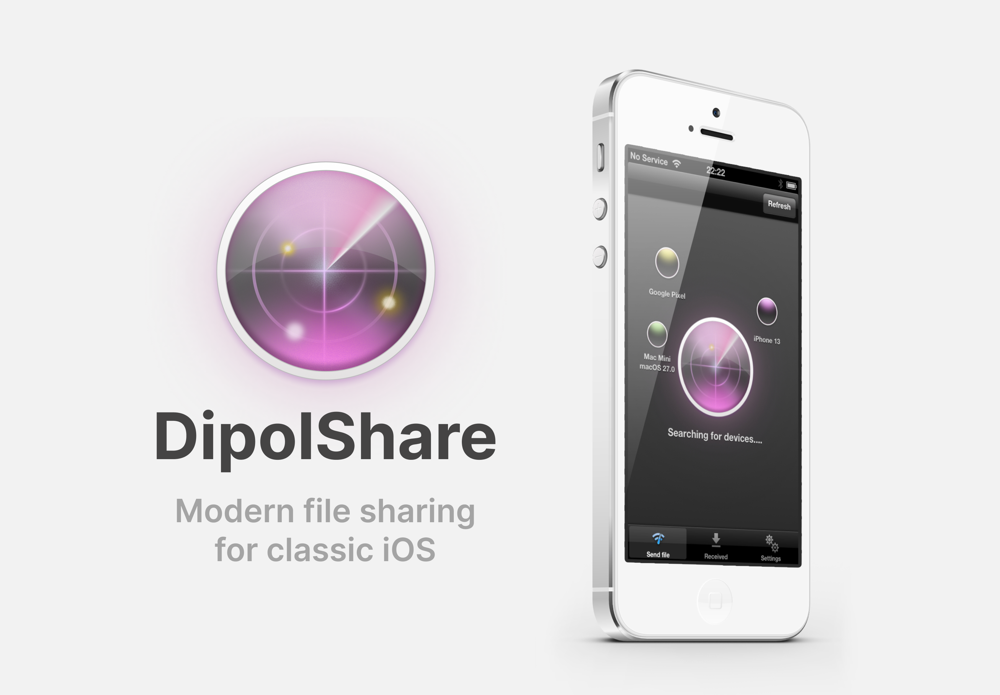

# DipolShare - LocalSend client for classic iOS (4.2+)

<p align="center">
  
</p>

[LocalSend](https://localsend.org/) is an open-source cross-platform app for sharing files between nearby devices over a local network. It works without an account, cloud storage, or an internet connection.

DipolShare brings LocalSend-compatible sharing to classic iOS devices. You can send photos and videos from the device library, accept incoming files, and send or receive clipboard text with modern devices running LocalSend on **iOS, Android, Windows, Linux, and macOS**.

## Features

- Send and receive files and clipboard text
- Discover nearby LocalSend devices
- Browse received files in the app
- Back up all contacts as a dated `.vcf` file: choose a device → **More...** → **Back Up Contacts** → **Send**

## Compatibility

| Category | Supported |
| --- | --- |
| Supported OS | iOS 4.2+ |
| | iOS 5 |
| | iOS 6 |
| Architecture | ARMv6 (iPhone 3G, iPod touch 2nd generation) |
| | ARMv7 |

Both devices must be on the same local network.

## Security

DipolShare encrypts transfers with TLS 1.2 and keeps its private key in the iOS Keychain.

## Requirements

The app requires as a jailbroken iOS with AppSync installed.

TLSFix is not required for file sharing. The optional version check uses system HTTPS, which may need TLSFix enabled for DipolShare and updated trusted certificates on older iOS versions.

## The app was tested on:

### these devices:

- iPhone 3GS/4S/5
- iPod touch 2g/4
- iPad 1st generation

### with these versions

- iOS 4.2.1
- iOS 5
- iOS 6

## Version notifications

The app checks `updates/latest.json` over HTTPS when it becomes active, at most once every 15 minutes per app session. A successful response containing a strictly newer compatible version shows an informational alert when the app is idle. Offline requests, HTTP errors, invalid JSON, incompatible versions, and equal or older versions produce no UI.

- **Dismiss** ignores that version on subsequent checks.
- **Remind Later** postpones that version for 24 hours. A later release can still be announced.
- The app never downloads an IPA or installs an update.

The test manifest announces **1.0.4** while the app remains **1.0.3**. `DipolShareUpdateManifestURL` in `Configuration/Info.plist` currently points at the `v1.0.4` branch:

```text
https://raw.githubusercontent.com/bronley/dipolshare/v1.0.4/updates/latest.json
```

Before shipping, point this setting at a stable branch such as `main` and announce only released versions. Keep the manifest path stable. The optional `minimumOSVersion` prevents notifying devices that cannot run a release. Version strings contain one to four dot-separated numeric components; prerelease labels are ignored.

The manifest is fetched with `NSURLConnection` using the device's system certificate validation, including user-installed trusted certificates. No CA bundle ships with the app. Certificate and connection failures remain silent; redirects and responses larger than 16 KiB are rejected, and requests are cancelled after 20 seconds. File transfers continue to use OpenSSL and certificate fingerprint verification.

## Third-party software

- [OpenSSL 3.5.8](https://openssl-library.org/) — TLS support, licensed under [Apache 2.0](Vendor/OpenSSL/LICENSE-OpenSSL.txt).
- [JSONKit 1.4](https://github.com/johnezang/JSONKit) — JSON parsing, used under its [BSD license](Vendor/JSONKit/LICENSE-JSONKit.txt).

## Copyright

© 2026 Oleh Bespalov - Love is in the Tech. All rights reserved for DipolShare’s original code and artwork. Third-party components retain their respective licenses.
